AI and software engineer from Quito, Ecuador. Machine learning, LLM agents and quantum computing.

**Projects**

- [neuroscape](https://github.com/Ericson3100/neuroscape): neural network training visualized in 3D
- [poe2-build-planner-agent](https://github.com/Ericson3100/poe2-build-planner-agent): LLM agent with RAG
- [XTTSv2-pipeline](https://github.com/Ericson3100/XTTSv2-pipeline): voice cloning
- [haproxy-keepalived-ha](https://github.com/Ericson3100/haproxy-keepalived-ha), [prometheus-thanos-minio-stack](https://github.com/Ericson3100/prometheus-thanos-minio-stack): infrastructure templates

**Stack**: Python, Java, TypeScript, PyTorch, LangGraph, Spring Boot, React, Docker

[LinkedIn](https://www.linkedin.com/in/ericson-lopez)
